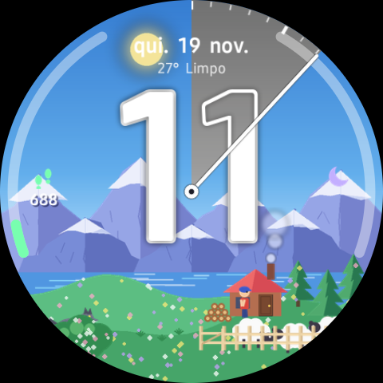
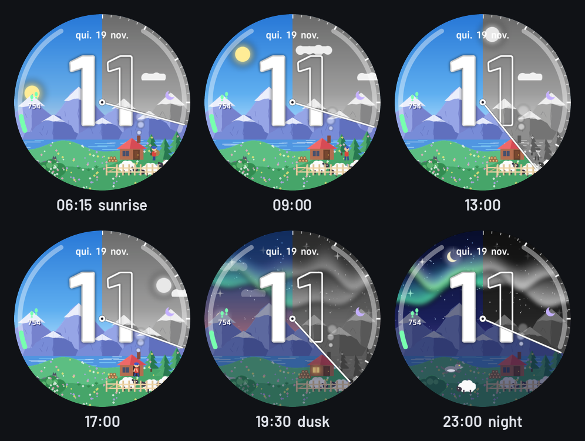
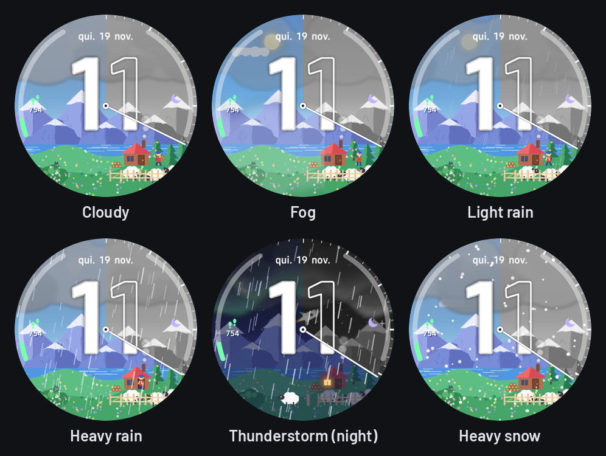
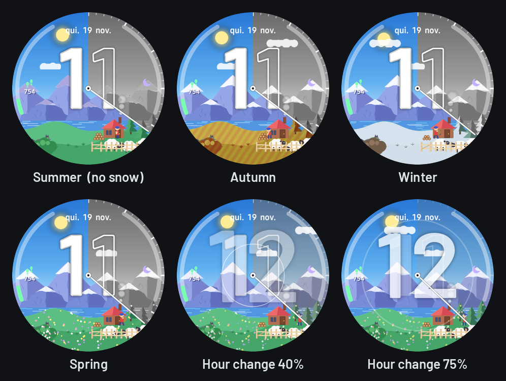

# aurora-sweep-watchface

An animated Wear OS watch face where a small farm follows the real sun, weather and seasons, with a large sweeping-hour clock on top.

  



## Overview

This is a fork of [Aurora Farm](https://github.com/ArtTemiiss/aurora-farm-watchface) by Bharathy (MIT), which
plays a charming 45-second day/night story. The original loop switches day and night every few seconds, so the
scene never tells you what time it actually is. Aurora Sweep keeps the original art and story, ties the scene to
the real clock, local sunrise/sunset, the watch's weather data and the time of year, and replaces the digital
clock with a large hour numeral and a sweeping minute hand. The clock layout is inspired by the minimalist
"Vanish" watch face concept (big hour, elapsed part of the hour fades); no assets from it are used.

## Features

- Shows day, dusk and night from the real time, with sunrise and sunset computed for a configurable location.
- Moves the sun and the moon along an arc around the dial according to the actual time.
- Renders live weather from the watch: overcast sky, storm clouds, light/normal/heavy rain, snow, fog,
  lightning, plus temperature and condition name under the date.
- Changes scenery with the seasons: autumn colors, frosty winter grass, spring flowers, snow-free mountains in summer.
- Follows a daily routine: the boy chops wood only during working daylight hours; cabin lights go on at dusk,
  off at 23:00 and on again just before sunrise.
- Turns the elapsed part of the hour black and white (same brightness), behind the minute hand, with optional darkening.
- Plays an hour-change animation from :59:57 (ring opens, the next hour zooms in).
- Keeps the original step arc, sleep complication, tap-to-"Baa!" sheep and flickering cabin windows.

## How it works

The face is pure Watch Face Format XML (no app code). Everything is generated from the original
`watchface.orig.xml` by two Python scripts:

```
watchface.orig.xml ──► timemodel.py ──► patch_xml.py ──► source/res/raw/watchface.xml ──► build.sh ──► APK
                       (time, sun,        (hour numeral,
                        weather, seasons)  sweep, flip)
gen_assets.py / gen_assets2.py ──► source/res/drawable-nodpi/*.png (numerals, hand, weather, seasons)
```

Technically non-obvious decisions:

- **One loop time, two stories.** The original drives every character from `t = (seconds mod 45)`. Story
  elements are remapped to a day-only segment (t 0–18) during daylight and a night-only segment (t 22–42) at
  night, so the boy never appears at 2 a.m. and the wolf never appears at noon. Continuous motion (water,
  clouds, smoke) uses unwrapped seconds so nothing jumps at the loop boundary.
- **Shared values via `<Reference>` (WFF 4).** Sun position, day factor, weather and season weights are computed
  once per frame in invisible nodes and read as `[REFERENCE.name]`. Inlining them made the XML 190 KB and cost
  about 1.5x the original's CPU; with references the XML is 54 KB and CPU use is below the original's.
- **Black and white sweep.** A `SATURATION` blend-mode arc (WFF 3+) removes color from the elapsed sector
  without changing luminance.
- **Sunrise model.** Half-day length is fitted at build time from latitude (solstice hour angles) as
  `mean + amplitude * cos(2π(day − 355)/365)`, and solar noon from longitude and UTC offset.
  Seasons shift by half a year in the northern hemisphere.

## Requirements

- A Wear OS watch with Watch Face Format 4 support (Wear OS 6). Tested only on a Galaxy Watch6 Classic (SM-R965F).
- To build: Python 3 with Pillow, a JDK, Android build-tools (`aapt2`, `zipalign`, `apksigner`) and an
  `android.jar` (API 34+).
- `adb` with wireless debugging enabled on the watch, to install.

## Quick start

Install the prebuilt APK:

1. On the watch: Settings → About watch → Software information, tap Software version 7 times.
2. Settings → Developer options: enable ADB debugging and Wireless debugging.
3. Pair and connect with the codes shown on the watch:
   ```
   adb pair <ip:pairing-port>
   adb connect <ip:port>
   ```
4. Install and activate:
   ```
   adb install AuroraSweep.apk
   adb shell am broadcast -a com.google.android.wearable.app.DEBUG_SURFACE \
     --es operation set-watchface --es watchFaceId com.cascodigital.watchface.aurorasweep
   ```
5. Turn Wireless debugging off afterwards (it uses battery).

Build from source:

```
export ANDROID_HOME=~/Android/Sdk JAVA_HOME=/path/to/jdk
WF_LAT=-30.03 WF_LON=-51.23 WF_UTC_OFFSET=-3 python3 patch_xml.py
./build.sh            # -> dist/aurora-sweep.apk
```

`python3 gen_assets.py && python3 gen_assets2.py` regenerates the images (the generated PNGs are committed).
The first build creates a local signing key in `keys/` (gitignored); keep it, updates must use the same key.

## Configuration

Build time:

| Variable / key | Required | Default | Description |
|---|---|---|---|
| `WF_LAT` | No | `-30.03` | Latitude used for sunrise/sunset and hemisphere (seasons) |
| `WF_LON` | No | `-51.23` | Longitude used for solar noon |
| `WF_UTC_OFFSET` | No | `-3` | Standard UTC offset of the location (hours) |
| `ANDROID_HOME` | Yes* | — | SDK root; *or set `BUILD_TOOLS` and `ANDROID_JAR` directly |
| `JAVA_HOME` | Yes | — | JDK used by `apksigner`/`keytool` |
| `KEYSTORE`, `KEYSTORE_PASS_FILE` | No | `keys/sign.jks`, `keys/sign.pass` | Signing key |
| `.buildenv` | No | — | Optional file sourced by `build.sh`/`shoot.sh` for local overrides |

On the watch (long-press the face → Customize):

| Option | Default | Description |
|---|---|---|
| Color | White | Tint of the hour numeral, minute hand and ticks |
| Black and white behind the hand | On | Desaturates the elapsed part of the hour |
| Darken behind the hand | None | None / Light / Medium / Strong |
| 24-hour | On | 12/24-hour numeral |
| Sleep (complication) | Empty | Set to Samsung Health → Sleep for the right arc |

## Usage

`shoot.sh` is the development loop: it rebuilds with optional overrides, installs, activates the face and saves
screenshots. Overrides replace real data sources so a whole day, year or weather set can be checked in a minute:

```
./shoot.sh real 1 1 /tmp/now                                   # real build, one screenshot
./shoot.sh '{"m":"fract([SECONDS_IN_DAY] / 120) * 1440"}' 8 14 /tmp/day     # one day every 2 minutes
./shoot.sh '{"m":"600","cond":"floor(fract([SECONDS_IN_DAY] / 64) * 16)"}' 16 3 /tmp/wx   # all 16 weather codes
./shoot.sh '{"doy":"fract([SECONDS_IN_DAY] / 48) * 365"}' 12 3.4 /tmp/seasons       # a year every 48 s
```

Override keys: `m` (minute of day), `doy` (day of year), `cond` (`WEATHER.CONDITION`), `flip` (hour-change progress 0–1).

Screenshots below were taken on the watch with these overrides (fixed time, weather or day of year).

### Day cycle



### Weather



### Seasons and hour change



## Limitations

- Sunrise/sunset is an approximation (no equation of time); expect errors of up to ~15 minutes.
- Location is fixed at build time; the face does not read GPS.
- Weather depends on the watch's weather provider. Samsung reports code 14 (partly cloudy) with the name "Clear",
  so partly cloudy only slightly greys the sky.
- Animated scenes cost CPU while the screen is on (measured ~70% of one core on a Galaxy Watch6 Classic, vs ~85%
  for the original). The always-on display shows only the outlined hour, date and minute hand.
- Tap targets (sheep, cabin) are inherited from the original and were not re-verified after the clock overlay was added.
- Tested only on one watch model.

## License

MIT — see [LICENSE](LICENSE). Original Aurora Farm art and story by Bharathy (MIT). Barlow font by The Barlow
Project Authors, SIL Open Font License 1.1 — see [fonts/OFL.txt](fonts/OFL.txt).
